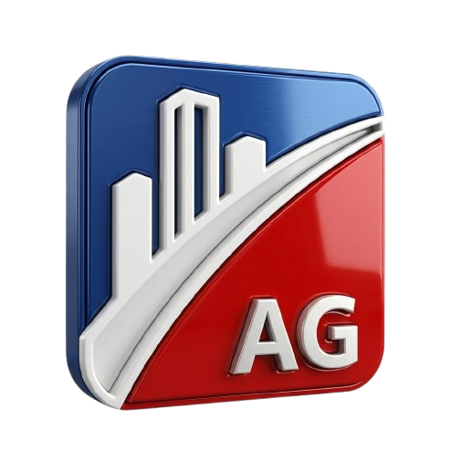
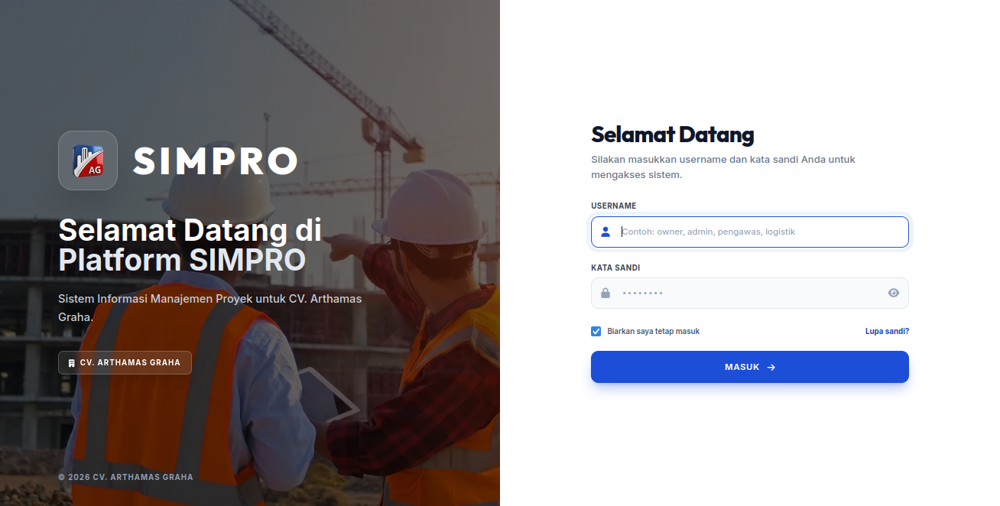
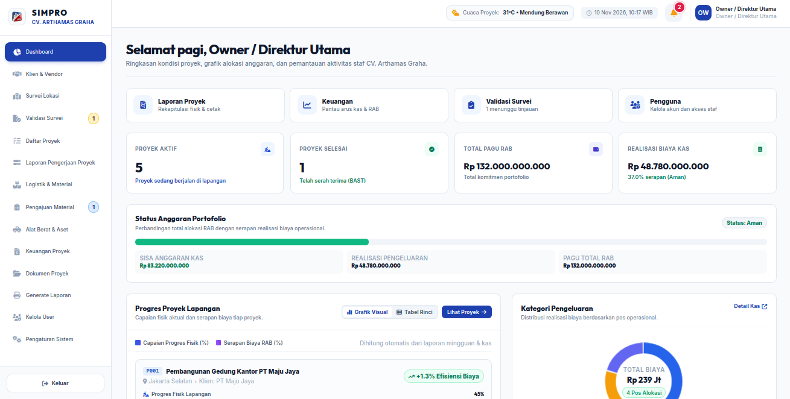
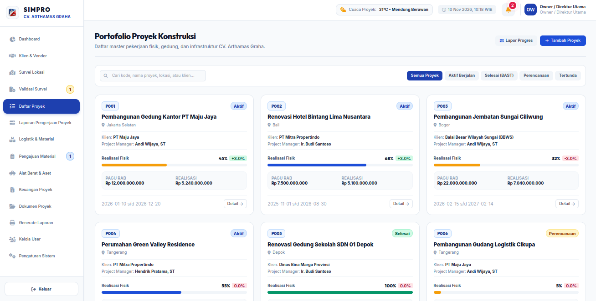
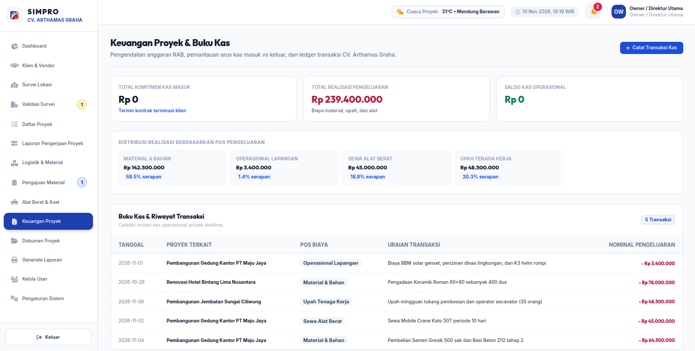
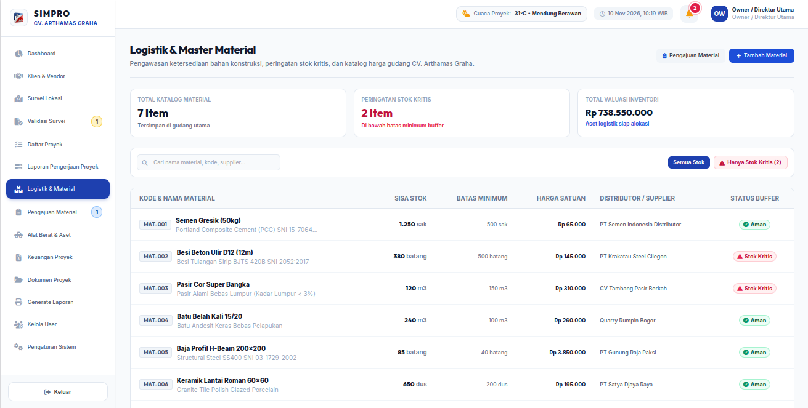
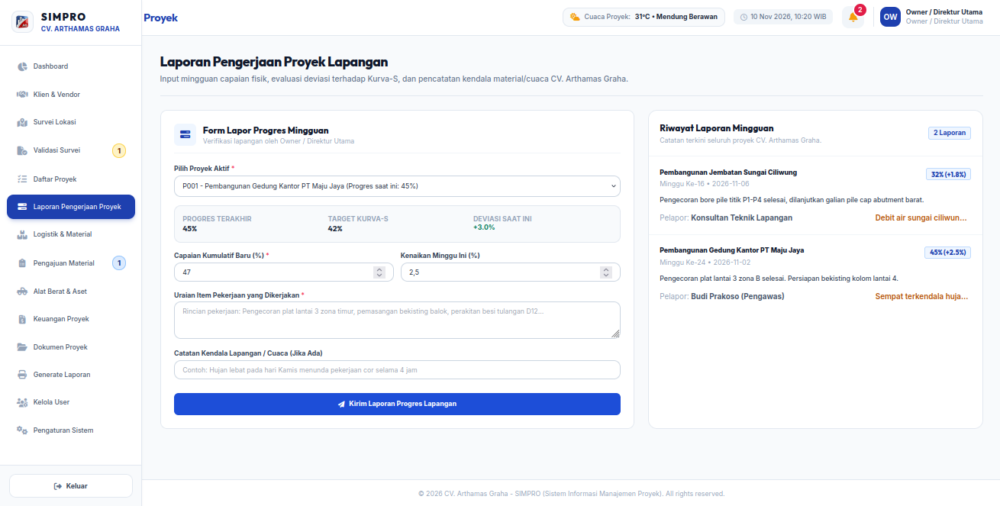
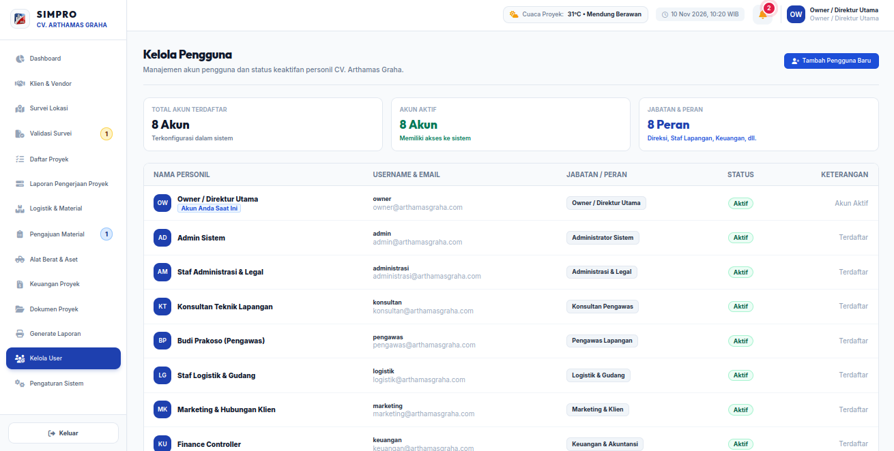
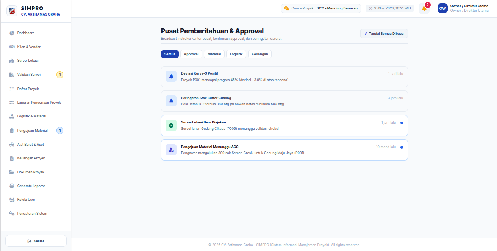

<div align="center">



<br />

[](https://react.dev/)
[](https://vitejs.dev/)
[](https://tailwindcss.com/)
[](https://expressjs.com/)
[](https://sqlite.org/)
[](https://supabase.com/)
[](https://vitest.dev/)
[](https://nodejs.org/)

# Sistem Informasi Manajemen Proyek (SIMPRO) CV. Arthamas Graha

Aplikasi Manajemen Proyek, Logistik Konstruksi, Realisasi Anggaran, dan Pelaporan Lapangan  

</div>

---

## 1. Deskripsi Proyek

Sistem Informasi Manajemen Proyek (SIMPRO) adalah aplikasi berbasis web yang dirancang khusus untuk memenuhi kebutuhan operasional dan tata kelola proyek konstruksi fisik pada CV. Arthamas Graha. Proyek ini dikembangkan sebagai pemenuhan Tugas Besar I (Evaluasi Praktik Tengah Semester) pada mata kuliah Perancangan dan Pemrograman Web.

Aplikasi ini menyatukan seluruh siklus manajemen konstruksi ke dalam satu platform terpadu, mulai dari pencatatan portofolio proyek, survei pra-konstruksi lapangan, pengadaan logistik material, pengendalian aset alat berat, pemantauan realisasi kas terhadap pagu anggaran Rencana Anggaran Biaya (RAB), pelaporan capaian progres fisik mingguan berbasis Kurva-S, digitalisasi arsip dokumen kontrak, hingga penerbitan laporan berkop surat resmi yang siap dicetak fisik maupun diekspor ke format digital.

Sistem menerapkan arsitektur Single Page Application (SPA) modern yang interaktif, responsif pada berbagai ukuran layar perangkat, mengutamakan standar aksesibilitas web, serta menerapkan sistem otorisasi multi-peran (Role-Based Access Control) berbasis 8 peran kerja internal perusahaan.

---

## 2. Kontribusi Pengembang (Developer Contribution)

Berikut adalah pembagian peran dan rincian kontribusi masing-masing anggota tim pengembang dalam pembangunan sistem SIMPRO CV. Arthamas Graha:

| Nama | Username | Contribute |
| :--- | :--- | :--- |
| **Daviz Arvaputa D** | [`@davizofficial`](https://github.com/davizofficial) | **Backend & Database**<br>Merancang dan membangun arsitektur server REST API Express.js, skema basis data relasional SQLite dan Supabase PostgreSQL, sistem autentikasi sesi token JWT, otorisasi Role-Based Access Control (RBAC) 8 peran, pencatatan transaksi kas keuangan, serta skrip otomatisasi pembersihan dan pengisian data uji. |
| **Rafael Putra Septava** | [`@RafaelSeptava`](https://github.com/RafaelSeptava) | **Front-End (UI/UX)**<br>Merancang tata letak antarmuka pengguna responsif (mobile, tablet, desktop) menggunakan Tailwind CSS, menerapkan identitas visual resmi CV. Arthamas Graha, struktur navigasi bilah sisi (sidebar) dan bilah atas (navbar), animasi transisi halus, serta perancangan komponen dashboard terpadu. |
| **Daffa Aufany Febrianto** | [`@DaffaA09`](https://github.com/DaffaA09) | **Front-End (Form Validation)**<br>Membangun sistem validasi input formulir di sisi klien pada seluruh formulir operasional (proyek, material, logistik, pengeluaran kas), proteksi integritas data masukan, penyajian pesan galat yang informatif dan ramah pengguna, serta animasi kerangka pemuatan (skeleton loader). |
| **Tony Hendrawan** | [`@Tony-Hendrawan`](https://github.com/Tony-Hendrawan/) | **Front-End (Fetch API)**<br>Menghubungkan antarmuka pengguna ke backend melalui Axios dan Fetch API, sinkronisasi state data dinamis secara realtime tanpa memuat ulang peramban, integrasi layanan prakiraan cuaca Open-Meteo BMKG, serta penanganan konektivitas jaringan. |

---

## 3. Spesifikasi Teknologi (Tech Stack)

Aplikasi dibangun menggunakan kombinasi teknologi web modern pada sisi antarmuka pengguna (frontend) dan antarmuka pemrograman aplikasi (backend REST API):

### 3.1. Lapisan Antarmuka Pengguna (Frontend)
- **Framework Utama**: React 18 (React.js versi 18.3.1) dengan bundler Vite yang menghadirkan kecepatan kompilasi tinggi dan Hot Module Replacement (HMR).
- **Tata Letak dan Desain**: Tailwind CSS versi 3.4 dipadukan dengan teknik modern CSS Flexbox dan CSS Grid untuk menjamin tata letak yang presisi dan adaptif.
- **Navigasi Halaman**: React Router DOM versi 6.28 yang mengelola navigasi Single Page Application (SPA) secara mulus tanpa memuat ulang seluruh halaman peramban.
- **Klien HTTP**: Axios versi 1.7 dengan konfigurasi interceptor terpusat untuk menangani pengiriman data, otentikasi token sesi, dan penanganan galat secara konsisten.
- **Ikonografi**: Font Awesome 6 Pro Parity dan Lucide Icons yang seragam untuk meningkatkan keterbacaan visual antarmuka.
- **Tipografi Resmi**: Google Fonts Outfit untuk elemen identitas, angka statistik, dan judul, serta Google Fonts Inter untuk teks isi, formulir, dan tabel data.

### 3.2. Lapisan Layanan Data dan Server (Backend API)
- **Runtime Lingkungan**: Node.js versi 20+ dengan kerangka kerja Express.js versi 4.21.
- **Basis Data Relasional Lokal**: SQLite 3 menggunakan driver berkecepatan tinggi better-sqlite3 dalam mode Write-Ahead Logging (WAL) dan penegakan integritas relasional foreign keys.
- **Basis Data Cloud (Siap Produksi)**: PostgreSQL melalui Supabase Cloud yang mendukung connection pooling untuk lingkungan serverless.
- **Keamanan dan Validasi**: Enkripsi kata sandi menggunakan bcryptjs, tanda tangan sesi token berbasis JSON Web Token (JWT) yang tersimpan pada HttpOnly Cookie, validasi skema masukan data menggunakan Zod, proteksi header HTTP menggunakan Helmet, pembatasan laju permintaan menggunakan express-rate-limit, serta proteksi Cross-Origin Resource Sharing (CORS).

### 3.3. Layanan Pihak Ketiga (Public API)
- **Open-Meteo Weather API**: Mengambil data prakiraan cuaca, suhu udara, kelembapan, dan kecepatan angin secara langsung untuk pemantauan kondisi keselamatan kerja fisik di lokasi proyek konstruksi.

### 3.4. Alat Pengujian dan Kualitas Kode
- **Otomasi Pengujian**: Vitest versi 2.1 dipadukan dengan React Testing Library, jsdom, dan Supertest dengan cakupan 126 berkas pengujian unit dan integrasi.
- **Standardisasi Kode**: ESLint versi 9 dan Prettier untuk penegakan kaidah penulisan kode bersih tanpa komentar naratif yang mengotori berkas sumber.

---

## 4. Strategi Percabangan Git (Branch Strategy)

Pengembangan repositori menerapkan alur kerja Git terstruktur untuk menjamin kestabilan kode:

- **Branch main**: Berfungsi sebagai cabang produksi utama yang memuat kode stabil dan teruji penuh. Kode pada branch ini siap untuk dideploy ke lingkungan produksi.
- **Branch develop**: Berfungsi sebagai cabang integrasi harian. Seluruh implementasi komponen, perbaikan modul, dan pengujian digabungkan pada cabang ini sebelum dilakukan penggabungan akhir ke cabang utama.
- **Branch feature dan bugfix**: Cabang sementara yang dibuat untuk menyelesaikan modul spesifik (misalnya modul validasi survei atau konfigurasi database cloud) sebelum dilakukan proses peninjauan dan penggabungan ke branch develop.
- **Konvensi Pesan Commit**: Setiap pencatatan riwayat commit menggunakan format deskriptif standar software engineering, seperti feat untuk penambahan fitur baru, fix untuk perbaikan galat, refactor untuk perapian struktur kode, test untuk penambahan pengujian otomatis, dan docs untuk pembaruan dokumentasi.

---

## 5. Panduan Menjalankan Sistem di Komputer Lokal

Proyek ini telah dikonfigurasi agar dapat dijalankan dengan mudah pada komputer penguji atau dosen penilai tanpa memerlukan instalasi server database eksternal yang rumit.

### 5.1. Prasyarat Sistem
- Node.js versi 18 ke atas (disarankan versi 20 atau 22 LTS).
- NPM versi 9 ke atas.
- Peramban web modern (Google Chrome, Mozilla Firefox, Microsoft Edge, atau Safari).

### 5.2. Langkah Instalasi dan Menjalankan Aplikasi
1. Buka terminal dan masuk ke direktori proyek:
   ```bash
   cd simpro-arthamasgraha-react
   ```

2. Pasang seluruh dependensi proyek:
   ```bash
   npm install
   ```

3. Siapkan berkas konfigurasi lingkungan:
   ```bash
   cp .env.example .env
   ```

4. Jalankan server dan antarmuka aplikasi:

   **Opsi A: Menjalankan Bersamaan (Rekomendasi - Satu Terminal)**
   ```bash
   npm run dev
   ```
   Perintah ini akan menyalakan server backend REST API pada port 5000 dan server pengembangan Vite React pada port 5173 secara bersamaan.

   **Opsi B: Menjalankan Secara Terpisah (Dua Terminal)**
   - Terminal 1 (Menjalankan Server Backend API):
     ```bash
     node server/index.js
     ```
     Server backend Express akan aktif melayani permintaan API pada port 5000 (http://localhost:5000).
   - Terminal 2 (Menjalankan Frontend React):
     ```bash
     npm run dev:frontend
     ```
     Aplikasi frontend React akan aktif dan terbuka pada port 5173 (http://localhost:5173).

5. Buka peramban web dan akses alamat berikut:
   ```text
   http://localhost:5173
   ```

### 5.3. Perintah Tambahan untuk Pengujian dan Basis Data
- Menjalankan server backend secara mandiri:
  ```bash
  node server/index.js
  ```
- Membersihkan seluruh data operasional menjadi nol untuk pengujian:
  ```bash
  npm run db:clean
  ```
- Mengisi kembali data sampel proyek untuk kebutuhan demonstrasi:
  ```bash
  npm run db:seed
  ```
- Menjalankan 126 pengujian otomatis:
  ```bash
  npm run test
  ```
- Memeriksa kualitas kode dengan linter:
  ```bash
  npm run lint
  ```
- Membangun bundel produksi:
  ```bash
  npm run build
  ```

---

## 6. Panduan Penerapan ke Layanan Cloud (Deployment Setup)

Aplikasi telah dilengkapi konfigurasi deployment siap pakai untuk platform Vercel dan Supabase.

### 6.1. Persiapan Basis Data di Supabase
1. Masuk ke situs Supabase dan buat proyek baru dengan memilih lokasi server terdekat (Singapore).
2. Buka menu SQL Editor pada dashboard Supabase.
3. Buka berkas supabase/schema.sql pada repositori ini, salin seluruh kodenya, tempel pada SQL Editor Supabase, lalu jalankan (klik Run).
4. Masuk ke Project Settings, pilih menu Database, lalu salin connection string URI mode Transaction pada port 6543.

### 6.2. Penerapan Aplikasi di Vercel
1. Masuk ke dashboard Vercel dan impor repositori proyek ini.
2. Pada bagian Framework Preset, pilih Vite.
3. Pada bagian Environment Variables, masukkan variabel berikut:
   - NODE_ENV: production
   - DATABASE_URL: diisi connection string PostgreSQL Supabase dari langkah sebelumnya.
   - SUPABASE_URL: diisi alamat URL proyek Supabase.
   - SUPABASE_ANON_KEY: diisi anon public key Supabase.
   - JWT_SECRET: diisi string rahasia acak minimal 32 karakter untuk enkripsi token login.
4. Klik tombol Deploy. Vercel akan memproses build frontend dan mengarahkan rute API ke serverless function secara otomatis melalui konfigurasi vercel.json.

---

## 7. Dokumentasi Visual Antarmuka Aplikasi

Berikut adalah dokumentasi tangkapan layar antarmuka pengguna SIMPRO CV. Arthamas Graha beserta uraian fungsinya:

### 7.1. Halaman Autentikasi Masuk Platform


Halaman login menyajikan formulir autentikasi pengguna dengan enkripsi kata sandi berbasis bcrypt. di halaman ini login menggunakan username dan password yang diberikan oleh pemilik sistem

### 7.2. Dashboard Eksekutif dan Pemantauan Kondisi Proyek


Halaman dashboard menampilkan ringkasan eksekutif yang mencakup empat kartu metrik utama (proyek aktif, proyek selesai, total alokasi pagu anggaran, dan realisasi biaya kas), diagram alokasi biaya interaktif dalam bentuk grafik donat SVG murni, diagram perbandingan capaian fisik proyek terhadap rencana Kurva-S, pemantauan cuaca lokasi secara langsung melalui Open-Meteo API, serta daftar pemantauan aktivitas staff terbaru.

### 7.3. Portofolio Proyek dan Pengendalian Capaian Fisik


Halaman portofolio proyek memuat kartu proyek yang menampilkan kode proyek, nama pekerjaan, lokasi pekerjaan, persentase progres fisik aktual, alokasi anggaran, status deviasi, dan manajer penanggung jawab. Tersedia bilah pencarian dan tombol penyaring status pekerjaan (aktif, selesai, perencanaan, tertunda).

### 7.4. Operasional Keuangan dan Pembukuan Kas Proyek


Modul keuangan mengelola catatan transaksi arus kas masuk dan keluar proyek. Pengguna dengan kewenangan akuntansi dapat memantau serapan anggaran per pos pengeluaran (material, upah tenaga kerja, sewa alat berat, operasional lapangan, dan subkontraktor) serta mencatat mutasi pengeluaran kas baru melalui formulir modal terintegrasi.

### 7.5. Operasional Logistik dan Manajemen Material Gudang


Halaman logistik menyajikan katalog material konstruksi lengkap dengan satuan volume, harga satuan standar, nama distributor resmi, serta kalkulasi otomatis terhadap batas minimum persediaan (buffer stock). Sistem secara otomatis menandai material yang berada pada status kritis agar pengadaan dapat segera dilakukan sebelum pekerjaan lapangan terhenti.

### 7.6. Formulir Pelaporan Progres Fisik Lapangan


Formulir pelaporan progres mingguan digunakan oleh pengawas lapangan dan konsultan pengawas untuk menginput capaian persentase pekerjaan fisik aktual, catatan kendala teknis, serta kondisi cuaca lapangan. Sistem secara otomatis menghitung nilai deviasi capaian aktual terhadap target rencana.

### 7.7. Manajemen Pengguna dan Matriks Hak Akses Spatie RBAC


Halaman administrasi pengguna memberikan kendali penuh kepada Administrator Sistem dan Direksi untuk mengelola data personil, memetakan peran kerja, mengaktifkan atau menonaktifkan status akun staf, serta memastikan setiap akun hanya dapat mengakses data dan tombol tindakan yang sesuai dengan matriks kewenangannya.

### 7.8. Pusat Notifikasi Terpadu


Pusat notifikasi menyajikan daftar pemberitahuan sistem secara kronologis mengenai pengajuan material yang membutuhkan persetujuan, berkas survei lokasi baru yang diinput pengawas, serta pembaruan progres proyek. Dilengkapi tombol penanda bahwa pemberitahuan telah dibaca secara individual maupun massal.

---

## 8. Keterhubungan Halaman dan Navigasi Mulus (Pages Connected)

Aplikasi memiliki 15 rute halaman yang saling terkoneksi secara dinamis dalam satu siklus alur kerja tanpa pemuatan ulang peramban (zero reload):

| No | Nama Halaman | Alamat URL | Keterkaitan dan Alur Navigasi Antar Halaman |
| :---: | :--- | :--- | :--- |
| 1 | Halaman Login | /login | Titik masuk utama autentikasi; mengarahkan pengguna ke Dashboard setelah sesi terverifikasi sah. |
| 2 | Dashboard Eksekutif | / | Terhubung langsung melalui kartu tautan cepat ke Portofolio Proyek, Buku Kas, Pengajuan Material, dan Validasi Survei. |
| 3 | Portofolio Proyek | /projects | Menampilkan seluruh proyek; setiap kartu proyek terhubung ke halaman rincian detail proyek masing-masing. |
| 4 | Rincian Detail Proyek | /projects/:id | Memuat 5 tab data proyek (Ringkasan Teknis, Bill of Quantities, Transaksi Kas, Dokumen CAD, dan Riwayat Laporan Progres). |
| 5 | Mitra dan Klien | /clients | Terhubung dengan data master proyek; memungkinkan pendaftaran klien baru yang langsung menjadi opsi pilihan pada pembuatan proyek. |
| 6 | Survei Lokasi Lapangan | /site-surveys | Menampung hasil survei fisik lahan; berkas survei yang membutuhkan validasi terhubung langsung ke meja persetujuan direksi. |
| 7 | Validasi Survei (ACC) | /site-surveys/approvals | Khusus untuk peran Direksi; terhubung ke formulir instruksi revisi teknis atau pengesahan ACC survei. |
| 8 | Master Material Gudang | /materials | Terhubung dengan alur pengadaan logistik; stok berkurang otomatis ketika material diterima di proyek. |
| 9 | Pengajuan Material | /material-requests | Formulir permohonan material oleh pengawas yang membutuhkan verifikasi anggaran oleh pihak Keuangan dan persetujuan Owner. |
| 10 | Alat Berat dan Aset | /equipments | Memantau lokasi alat berat; terhubung dengan proyek aktif tempat alat berat tersebut sedang ditugaskan. |
| 11 | Keuangan dan Kas | /finance | Pembukuan mutasi pengeluaran kas yang secara otomatis memperbarui nilai serapan biaya pada proyek terkait di dashboard. |
| 12 | Pelaporan Progres | /progress | Form input laporan mingguan yang langsung memperbarui persentase capaian fisik pada portofolio dan Kurva-S proyek. |
| 13 | Dokumen dan Arsip | /documents | Repositori digital pengarsipan berkas kontrak, gambar kerja arsitektur DED CAD, dan berita acara serah terima pekerjaan. |
| 14 | Rekapitulasi Laporan | /reports | Halaman rekapitulasi eksekutif dengan tata letak siap cetak berkop surat resmi CV. Arthamas Graha serta fitur ekspor berkas CSV. |
| 15 | Manajemen Pengguna | /users | Halaman pengaturan akun staf internal, pengubahan peran kerja, dan kontrol status keaktifan personil. |
| 16 | Pengaturan Sistem | /settings | Mengelola profil resmi instansi CV. Arthamas Graha (alamat kantor, kontak, email, dan integrasi penyimpanan). |
| 17 | Pusat Notifikasi | /notifikasi | Feed pemberitahuan sistem yang dapat diakses langsung melalui ikon lonceng pada bilah navigasi atas. |
| 18 | Akses Ditolak (403) | /forbidden | Ditampilkan otomatis oleh rute pengaman apabila pengguna mencoba membuka modul di luar batas izin perannya. |

### Mekanisme Navigasi Mulus (Smooth Navigation):
- Navigasi dikelola oleh komponen Link dan useNavigate dari React Router DOM v6 tanpa memicu permintaan dokumen HTML baru ke server.
- Terdapat indikator garis biru tipis di bagian paling atas layar yang bergerak halus menandai transisi perpindahan halaman.
- Seluruh modul halaman menggunakan teknik code-splitting berbasis React.lazy dan Suspense, sehingga aset kode JavaScript tiap halaman hanya diunduh saat pertama kali dibuka untuk menjaga performa rendering tetap instan.

---

## 9. Penerapan Kerangka Kerja (Framework Implementation)

Penerapan React pada proyek ini mengikuti standar arsitektur perangkat lunak berbasis komponen modern yang terstruktur rapi:

### 9.1. Arsitektur Komponen Modular dan Reusable
Setiap bagian antarmuka dipisahkan ke dalam komponen-komponen mandiri yang dapat digunakan kembali pada berbagai konteks:
- Komponen Dialog dan Modal: Komponen Modal dan ConfirmDialog menyediakan antarmuka pop-up yang dapat dipakai ulang di berbagai halaman dengan menangani penekanan tombol Escape dan perangkap fokus keyboard.
- Komponen Otorisasi Bersyarat: Komponen Can menerima properti permission dan secara deklaratif mengatur apakah suatu tombol atau tabel boleh ditampilkan kepada pengguna yang sedang login.
- Komponen Visualisasi Data: Komponen DonutExpenseChart dan ProjectComparisonChart menerima data array murni dan merender grafik visual SVG secara mandiri.
- Komponen Umpan Balik Pengguna: Komponen SkeletonLoader menyajikan animasi shimmer saat pengambilan data berlangsung, ErrorMessage menyediakan tombol coba lagi saat sambungan terganggu, dan PageLoader menyajikan indikator transisi rute.

### 9.2. Pola Manajemen State
- Context API (AuthContext): Mengelola status autentikasi global, data profil pengguna yang aktif, serta daftar izin Spatie RBAC yang dimiliki pengguna. Informasi sesi dilindungi dan tidak bergantung pada penyimpanan localStorage yang rentan eksploitasi XSS.
- Custom Hooks (useClients): Memisahkan logika pemanggilan API, perhitungan metrik kategori klien, pemfilteran data, dan penanganan status pemuatan ke dalam hook mandiri di luar komponen tampilan antarmuka.
- Optimasi Kinerja React: Menggunakan useMemo untuk memoize kalkulasi agregasi data statistik dan useCallback untuk menjaga stabilitas referensi fungsi penanganan aksi dari render ulang yang tidak perlu.

### 9.3. Penegakan Aksesibilitas (Accessibility) dan Semantik HTML
- Penggunaan elemen HTML5 semantik secara tepat pada seluruh struktur halaman (header, nav, main, section, aside, footer, article, dan table).
- Penyediaan atribut aksesibilitas lengkap meliputi aria-label pada tombol ikonik, aria-modal pada jendela dialog, aria-hidden pada ornamen visual, dan role="tablist" pada komponen tabulasi.
- Seluruh kode lolos pemeriksaan ketat aturan aksesibilitas ESLint (jsx-a11y) dan menjamin kontras warna memenuhi standar WCAG.

---

## 10. Akun Pengguna Default untuk Pengujian Sistem

Sistem menyediakan 8 akun pengguna dengan variasi hak akses sesuai struktur organisasi CV. Arthamas Graha (seluruh akun menggunakan kata sandi awal: password):

| Peran (Role) | Nama Pengguna (Username) | Kata Sandi | Deskripsi Wewenang dan Tanggung Jawab |
| :--- | :--- | :--- | :--- |
| Owner / Direktur Utama | owner | password | Akses menyeluruh ke seluruh modul sistem, persetujuan akhir survei pra-konstruksi, dan pengesahan pengadaan material. |
| Administrator Sistem | admin | password | Pengaturan konfigurasi aplikasi, manajemen pengguna, status akun personil, dan pemeliharaan basis data. |
| Keuangan & Akuntansi | keuangan | password | Pengendalian realisasi kas operasional proyek, verifikasi pengajuan biaya material, dan analisis pagu anggaran RAB. |
| Logistik & Gudang | logistik | password | Pengelolaan persediaan stok material gudang, pemantauan status buffer stock kritis, dan penugasan armada alat berat. |
| Pengawas Lapangan | pengawas | password | Pelaporan progres fisik mingguan, pencatatan hasil survei lokasi lahan, dan pengajuan kebutuhan material ke gudang. |
| Konsultan Pengawas | konsultan | password | Peninjauan teknis capaian proyek, validasi deviasi fisik pekerjaan, dan peninjauan dokumen gambar kerja CAD. |
| Marketing & Klien | marketing | password | Pengelolaan direktori relasi mitra klien/instansi pemerintah dan pemantauan ringkasan portofolio proyek. |
| Administrasi & Legal | administrasi | password | Pengarsipan dokumen legalitas kontrak kerja SPK, berita acara pekerjaan, dan pencetakan rekapitulasi portofolio resmi. |

---


